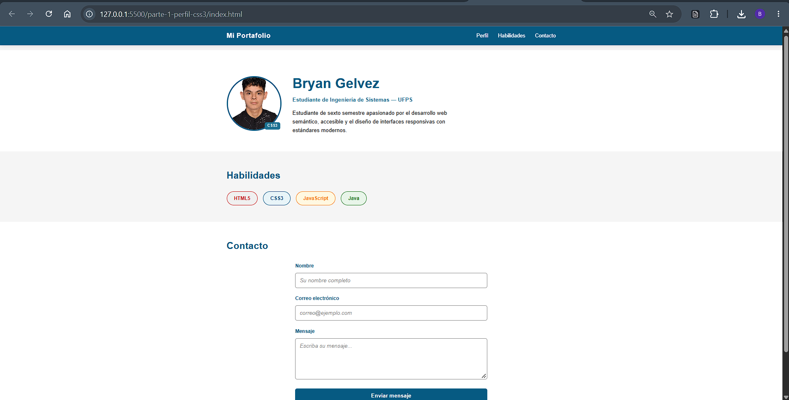
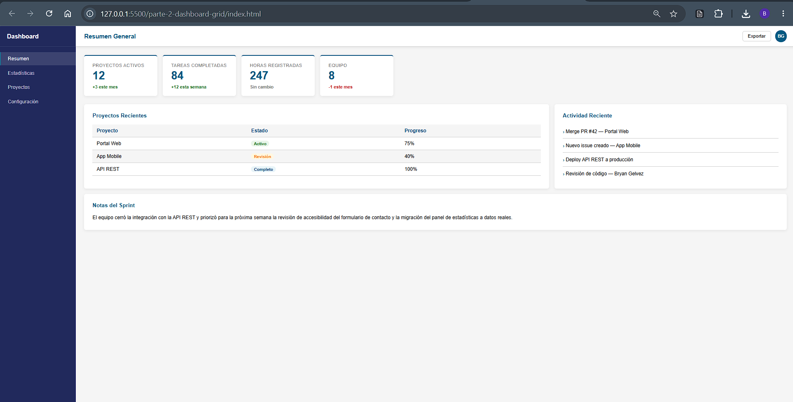
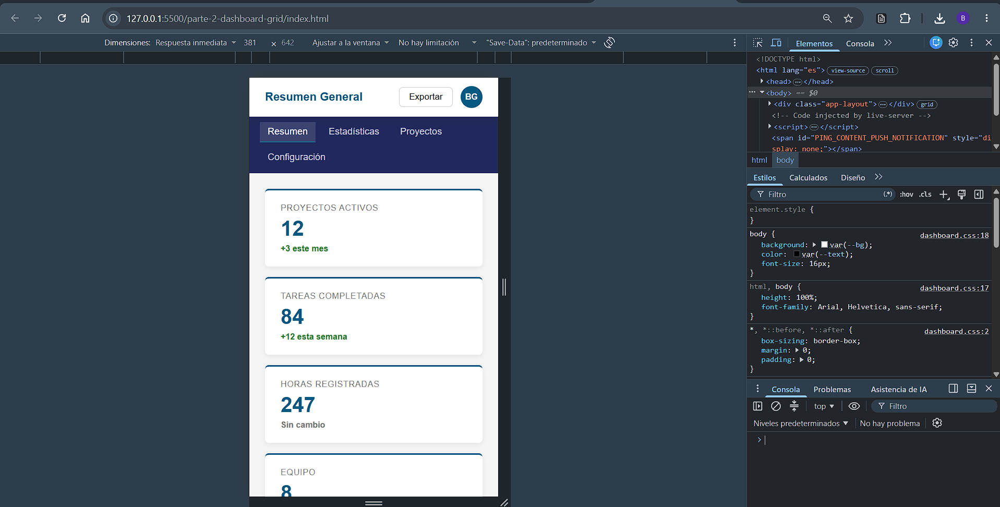

# Post-contenido — Unidad 3: CSS3 Básico

**Estudiante:** Bryan Sneider Gelvez Toloza  
**Carrera:** Ingeniería de Sistemas — 7° Semestre  
**Universidad:** Universidad Francisco de Paula Santander (UFPS)  
**Año:** 2026  

## Descripción
Repositorio del laboratorio de la Unidad 3 de Programación Web — Séptimo Semestre (`Gelvez-post1-u3`). Contiene dos partes: página de perfil con selectores CSS avanzados, Box Model y posicionamiento (`parte-1-perfil-css3/`) y dashboard responsivo con CSS Grid y Flexbox (`parte-2-dashboard-grid/`).

## Parte 1 — Página de perfil
Página de perfil personal que implementa selectores CSS avanzados, `box-sizing: border-box`, posicionamiento (`fixed`/`relative`/`absolute`), una escala de espaciado con Custom Properties (`--space-3xs` a `--space-3xl`), tipografía fluida con `clamp()` en el nombre de perfil y formulario de contacto accesible con estados `:focus`. Ver `parte-1-perfil-css3/`.

## Parte 2 — Dashboard con Grid y Flexbox
Dashboard responsivo con layout principal en CSS Grid (`grid-template-areas`), sidebar y topbar en Flexbox, stat-cards con Grid `auto-fill` responsivo, panel de contenido en proporción `2fr/1fr` con un tercer panel ("Notas del Sprint") posicionado mediante colocación explícita de Grid (`grid-column: 1 / -1`), y tabla de proyectos con franjas zebra vía `:nth-child(even)`. Sin frameworks CSS externos. Ver `parte-2-dashboard-grid/`.

## Decisiones de diseño

### Parte 1 — Estrategia de especificidad para validación
Se eligió la **Estrategia A (`input:invalid:not(:placeholder-shown)`)** con especificidad `(0,0,2,0)`. Se prefirió esta alternativa sobre la anidación por clase porque aprovecha la validación nativa de HTML5 únicamente después de que el usuario ha ingresado texto en el campo, evitando que todo el formulario aparezca marcado en rojo al cargar la página por primera vez. Además, al declararse antes de la regla `input:focus` `(0,0,1,1)` y mantener ambos estados separados en propiedades de borde/sombra, el ring de foco azul sigue funcionando sin conflictos y sin recurrir en ningún punto a `!important`.

### Parte 2 — Breakpoint y estrategia de layout responsivo
Se eligió un **breakpoint de `768px`** junto con la **Estrategia Grid** (redefinición de `grid-template-columns` a `1fr` y `grid-template-areas` a `"topbar" "sidebar" "main"`). Al inspeccionar el dashboard en Chrome DevTools por debajo de `768px`, el sidebar fijo de `220px` restaba demasiado espacio horizontal al panel `2fr/1fr`, comprimiendo excesivamente las columnas de la tabla de proyectos. Se prefirió la Estrategia Grid sobre abandonar Grid hacia Flexbox porque permite conservar intacta la asignación de `grid-area` en los contenedores hijos (`.topbar`, `.sidebar`, `.dashboard-main`) y reordenar visualmente la navegación superior de forma limpia sin alterar el orden del HTML ni usar `order`.

## Cómo visualizar el proyecto
1. Clonar el repositorio: `git clone https://github.com/BryanGelvez23/Gelvez-post1-u3.git`
2. Abrir la carpeta en Visual Studio Code
3. Clic derecho en `index.html` (de cada parte) → "Open with Live Server"

## Capturas de pantalla

